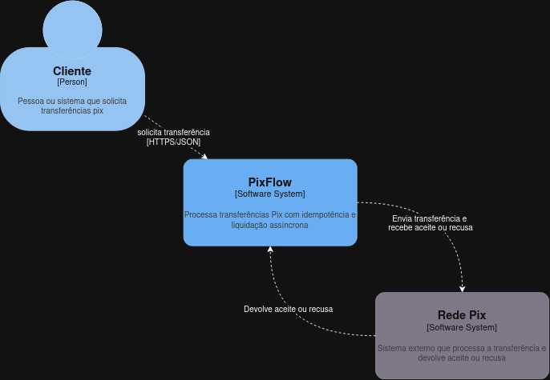
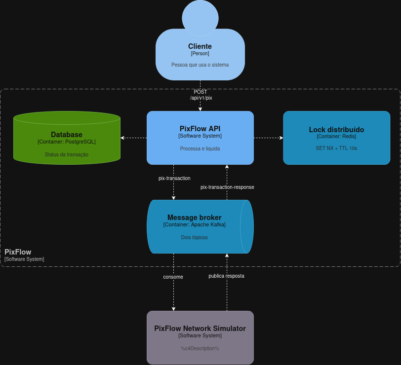

# PixFlow


Serviço de transferências Pix com idempotência e liquidação assíncrona. A API registra a transferência
como `PENDING`, envia para a rede Pix via Kafka e, quando a resposta chega, marca a transação como
`COMPLETED` ou `FAILED`.

## Arquitetura

**C4 nível 1 — Contexto**



**C4 nível 2 — Containers**



- **Hexagonal (Ports & Adapters):** o domínio não depende de framework; os casos de uso só conhecem interfaces.
- **Redis:** lock por chave de idempotência (`SET NX` + TTL), impedindo processamento duplicado em paralelo.
- **Kafka:** envio em `pix-transaction` e retorno em `pix-transaction-response`.
- **PostgreSQL:** fonte da verdade; uma requisição repetida devolve a transação já existente.
  O schema é versionado com **Flyway** (`src/main/resources/db/migration`).
- **Optimistic locking:** cada transação tem uma coluna `version` (`@Version`), então duas liquidações
  concorrentes não sobrescrevem uma à outra; a que perde é reprocessada pelo retry do consumer.

## Como executar

Pré-requisitos: Java 21 e Docker.

```bash
docker compose up -d
./mvnw spring-boot:run
```

A API fica disponível em `http://localhost:8080`.

| Serviço  | Endereço                |
|----------|-------------------------|
| API      | `http://localhost:8080` |
| Kafka UI | `http://localhost:8090` |
| pgAdmin  | `http://localhost:5050` |

### Configuração

Todas as conexões aceitam variáveis de ambiente, com valores padrão para o ambiente local:

| Variável                  | Padrão                                     |
|---------------------------|--------------------------------------------|
| `SERVER_PORT`             | `8080`                                     |
| `DB_URL`                  | `jdbc:postgresql://localhost:5432/pixflow` |
| `DB_USERNAME`             | `pixflow`                                  |
| `DB_PASSWORD`             | `pixflow`                                  |
| `KAFKA_BOOTSTRAP_SERVERS` | `localhost:9092`                           |
| `REDIS_HOST`              | `localhost`                                |
| `REDIS_PORT`              | `6379`                                     |

## API

`POST /api/v1/pix`

```json
{
  "idempotencyKey": "9b1deb4d-3b7d-4bad-9bdd-2b0d7b3dcb6d",
  "sourceAccountId": "a1b2c3d4-e5f6-7a8b-9c0d-1e2f3a4b5c6d",
  "destinationKey": "fulano@email.com",
  "destinationKeyType": "EMAIL",
  "amount": 150.50
}
```

`destinationKeyType`: `CPF`, `CNPJ`, `EMAIL`, `PHONE` ou `RANDOM`.

Retorna `201 Created` com a transação em status `PENDING`.

### Erros

Os erros seguem a [RFC 9457](https://www.rfc-editor.org/rfc/rfc9457) (`application/problem+json`):

```json
{
  "type": "about:blank",
  "title": "Invalid request",
  "status": 400,
  "detail": "One or more fields are invalid",
  "instance": "/api/v1/pix",
  "errors": [
    { "field": "amount", "message": "must be at least 0.01" }
  ]
}
```

| Status | Quando                                                                       |
|--------|------------------------------------------------------------------------------|
| `400`  | Campo ausente ou inválido, JSON malformado ou tipo de chave desconhecido     |
| `409`  | Transferência com a mesma chave de idempotência ainda em processamento       |
| `422`  | Regra de negócio violada (ex.: chave Pix fora do formato do tipo informado) |
| `500`  | Erro inesperado                                                              |

## Testes

```bash
./mvnw test
```
